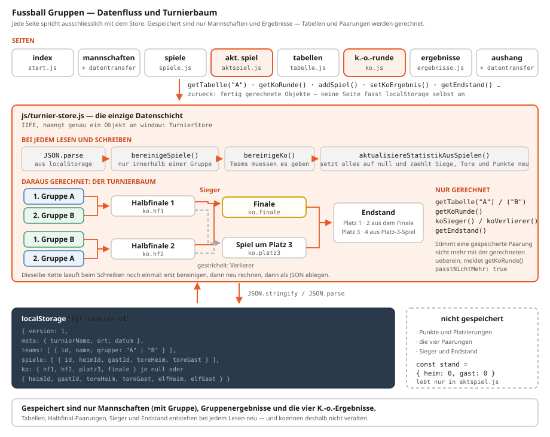

# Fussball Gruppen — die Web-Anwendung

> **Kurzfassung:** Eine Turnierverwaltung mit zwei Gruppen, Halbfinale und Finale, die vollständig im Browser läuft — ohne Installation, ohne Server, ohne Framework und ohne Build-Werkzeug. Acht HTML-Seiten teilen sich eine einzige Datenschicht (`turnier-store.js`), die alles unter einem Schlüssel im `localStorage` ablegt. Der tragende Gedanke: ==gespeichert werden nur Mannschaften, Gruppenergebnisse und die vier K.-o.-Ergebnisse==. Punkte, Platzierungen, Halbfinal-Paarungen, Sieger und Endstand stehen nirgends in der Datei — sie werden bei jedem Lesen neu berechnet und können deshalb gar nicht erst veralten.

<figure class="schirmbild">
  
  <figcaption>Die Seite „Tabellen“: zwei getrennte Tabellen, in jeder sind die beiden ersten Plätze grün hinterlegt — das sind die vier Mannschaften, die ins Halbfinale kommen. Die Zeile darüber meldet, ob die Gruppenphase schon beendet ist.</figcaption>
</figure>

---

## 🧭 Was die Anwendung ist

Dieses Projekt ist die Erweiterung von *Fussball Turnier Web* um das, was dort als Nächstes fehlte: **Gruppen und K.-o.-Runde.** Die Vorgängerfassung führt eine einzige Liga-Tabelle, hier gehört jede Mannschaft fest zu Gruppe **A** oder **B**, jede Gruppe spielt für sich jeder gegen jeden, und die beiden Besten jeder Gruppe erreichen das Halbfinale.

Alles andere ist geblieben: Keine Installation, kein Setup, keine Laufzeitumgebung. Man kopiert den Ordner auf einen Stick und öffnet `index.html`.

| Seite | Datei | Wozu |
|---|---|---|
| Start | `index.html` | Poster und Menü mit sieben Kacheln |
| Mannschaften | `mannschaften.html` | Teams anlegen, umbenennen, löschen, Gruppe wechseln; Demo-Daten; Sichern/Laden |
| Gruppenspiele | `spiele.html` | Begegnungen einer Gruppe wählen, Ergebnis eintragen, bearbeiten, löschen |
| Akt. Spiel | `aktspiel.html` | Große Live-Anzeige für Zuschauer (Beamer) |
| Tabellen | `tabellen.html` | Zwei Gruppentabellen mit Qualifikationsfarben |
| K.-o.-Runde | `ko.html` | Halbfinale, Spiel um Platz 3, Finale, Elfmeterschießen, Endstand |
| Ergebnisse | `ergebnisse.html` | Nur-Lesen-Liste aller Partien |
| Aushang | `aushang.html` | Druckfertige A4-Übersicht für den Schaukasten |

---

## 🏟️ Der Turniermodus

```
Gruppe A — jeder gegen jeden        Gruppe B — jeder gegen jeden
   1.            2.                    1.            2.
    │             └──────┐      ┌───────┘             │
    │                    │      │                     │
    └──── Halbfinale 1 ──┘      └── Halbfinale 2 ─────┘
            │     │                   │     │
         Sieger  Verlierer         Sieger  Verlierer
            │     └──── Spiel um Platz 3 ────┘
            └──────────── Finale ─────────────┘
```

- **Halbfinale 1:** 1. Gruppe A gegen 2. Gruppe B
- **Halbfinale 2:** 1. Gruppe B gegen 2. Gruppe A
- **Finale:** Sieger Halbfinale 1 gegen Sieger Halbfinale 2
- **Spiel um Platz 3:** die beiden Verlierer der Halbfinals
- In einem K.-o.-Spiel muss ein Sieger feststehen. Endet es unentschieden, verlangt das Programm das Ergebnis des **Elfmeterschießens**, sonst nimmt es das Ergebnis nicht an.

Diese Kreuzung — Erster der einen gegen Zweiten der anderen Gruppe — steht an genau einer Stelle im Code, in `getKoRunde()`. Alles andere, bis hinunter zum Aushang, leitet sich daraus ab.

---

## 📦 Woraus sie besteht

```
FussballGrupppen/
├── index.html  mannschaften.html  spiele.html  aktspiel.html
├── tabellen.html  ko.html  ergebnisse.html  aushang.html
├── assets/
│   ├── turnier-poster.jpg      Poster der Startseite
│   ├── logorw96.png            Signatur im Aushang-Kopf
│   └── icon.svg  icon-192.png  icon-512.png  apple-touch-icon.png
├── css/
│   ├── global.css              Farbvariablen, Grundschrift, box-sizing, Gruppen-Abzeichen
│   ├── layout.css              Kopfzeile, Navigation, Seitenrahmen
│   └── start / mannschaften / spiele / tabelle / ko / aushang / aktspiel .css
└── js/
    ├── turnier-store.js        die Datenschicht (982 Zeilen)
    ├── nav.js                  markiert den aktiven Menüpunkt (7 Zeilen)
    ├── datentransfer.js        Sichern und Laden als .json
    └── start / mannschaften / spiele / tabelle / ko / ergebnisse / aushang / aktspiel .js
```

Rund 6.100 Zeilen in 28 Dateien, davon knapp 1.000 im Store. Keine Abhängigkeit von außen: kein jQuery, kein React, kein npm, kein Bundler. Jede Seite lädt zwei bis vier `<script>`-Dateien und fertig.

---

## 🔑 Die eine wichtige Entscheidung

In einer Turnierverwaltung gibt es eine klassische Fehlerquelle: Man speichert die Tabelle *und* die Ergebnisse. Dann korrigiert jemand ein Ergebnis, die Tabelle wird vergessen — und beides widerspricht sich.

Mit Gruppen und K.-o.-Runde wird dieses Problem größer, nicht kleiner. Denn jetzt hängt nicht nur die Tabelle an den Ergebnissen, sondern die ganze **Turnierpyramide**: Wer im Halbfinale steht, folgt aus der Gruppentabelle; wer im Finale steht, folgt aus dem Halbfinale. Würde man die Paarungen speichern, müsste man sie bei jeder nachträglichen Korrektur eines Gruppenspiels von Hand nachziehen.

Die Anwendung speichert sie deshalb gar nicht erst. Im `localStorage` stehen nur:

- die **Mannschaften** mit ihrer Gruppe,
- die **Gruppenergebnisse**,
- die **vier K.-o.-Ergebnisse** (`hf1`, `hf2`, `platz3`, `finale`).

Alles andere — Punkte, Tordifferenz, Platzierung, wer gegen wen im Halbfinale spielt, wer das Finale erreicht, wer Turniersieger ist — wird bei jedem Lesezugriff neu ausgerechnet.



Die Punkterechnung ist dieselbe wie im Vorgängerprojekt. Jedes Team wird zuerst auf null gesetzt, dann laufen alle Spiele durch:

```js
/** Punkte und Tore aller Mannschaften aus den Gruppenspielen neu rechnen. */
function aktualisiereStatistikAusSpielen(teams, spiele) {
  const byId = new Map(teams.map((t) => [t.id, { ...t, ...leereStatistik() }]));

  for (const s of spiele) {
    const heim = byId.get(s.heimId);
    const gast = byId.get(s.gastId);
    if (!heim || !gast) continue;
    // … Spiele und Tore hochzählen, dann:
    if (th > tg)      { heim.siege += 1; heim.punkte += 3; gast.niederlagen += 1; }
    else if (th < tg) { gast.siege += 1; gast.punkte += 3; heim.niederlagen += 1; }
    else              { heim.unentschieden += 1; gast.unentschieden += 1;
                        heim.punkte += 1; gast.punkte += 1; }
  }

  return teams.map((t) => byId.get(t.id) || t);
}
```

Eine Gruppentrennung braucht es hier nicht: Ein Gruppenspiel geht ohnehin nur innerhalb einer Gruppe, also berührt es nur Mannschaften derselben Gruppe. Dafür sorgt eine Stufe früher `bereinigeSpiele()`.

---

## 🗄️ Das Datenmodell

Alles liegt unter einem einzigen Schlüssel:

```js
const STORAGE_KEY = "fgr-turnier-v1";
const EXPORT_APP = "fgr-gruppen";
const GRUPPEN = ["A", "B"];
const KO_SLOTS = ["hf1", "hf2", "platz3", "finale"];
```

Der Inhalt ist ein JSON-Objekt mit fünf Feldern:

```json
{
  "version": 1,
  "meta":   { "turnierName": "Stadtmeisterschaft 2026",
              "ort": "Sportplatz Musterstadt",
              "datum": "2026-07-18" },
  "teams":  [ { "id": "a1b2…", "name": "FC Champions", "gruppe": "A", "punkte": 7, "…": "…" } ],
  "spiele": [ { "id": "c3d4…", "heimId": "a1b2…", "gastId": "e5f6…",
                "toreHeim": 3, "toreGast": 1, "erstelltAm": "2026-07-18T14:20:00Z" } ],
  "ko":     { "hf1": { "heimId": "a1b2…", "gastId": "e5f6…",
                       "toreHeim": 1, "toreGast": 1,
                       "elfHeim": 4, "elfGast": 2,
                       "erstelltAm": "2026-07-18T16:05:00Z" },
              "hf2": null, "platz3": null, "finale": null }
}
```

### Die Mannschaft

Gegenüber dem Vorgängerprojekt ist genau **ein Feld** hinzugekommen:

```js
/** @typedef {{
 *   id: string;
 *   name: string;
 *   gruppe: Gruppe;
 *   spiele: number;
 *   siege: number;
 *   unentschieden: number;
 *   niederlagen: number;
 *   toreErzielt: number;
 *   toreErhalten: number;
 *   punkte: number;
 * }} Mannschaft */
```

`gruppe` ist `"A"` oder `"B"` — und nichts sonst. Dafür sorgt eine kleine Funktion, durch die jeder Wert läuft, der von außen kommt:

```js
/** @param {unknown} wert */
function normalisiereGruppe(wert) {
  const g = String(wert || "").trim().toUpperCase();
  return GRUPPEN.includes(g) ? g : "A";
}
```

Ein fehlendes, falsch geschriebenes oder erfundenes Gruppenfeld wird damit zu `"A"`, statt einen dritten Zustand ins Datenmodell zu lassen. Das ist der Grund, warum es in der ganzen Anwendung keine Stelle gibt, die prüfen müsste, ob eine Gruppe überhaupt gültig ist.

Die Statistikfelder (`punkte`, `siege`, `toreErzielt` …) werden zwar **mitgeschrieben**, aber beim Lesen **nie geglaubt**. Sie sind ein Abfallprodukt des Schreibvorgangs; maßgeblich ist immer `spiele`. Der Export lässt sie deshalb auch ganz weg und schreibt nur `id`, `name` und `gruppe`.

### Das Gruppenspiel

```js
/** @typedef {{
 *   id: string;
 *   heimId: string;
 *   gastId: string;
 *   toreHeim: number;
 *   toreGast: number;
 *   erstelltAm: string;
 * }} Spiel */
```

Unverändert gegenüber dem Vorgängerprojekt — und bewusst **ohne** Gruppenfeld. Zu welcher Gruppe ein Spiel gehört, steht schon an den beteiligten Mannschaften. Ein eigenes Feld wäre eine zweite Wahrheit, die auseinanderlaufen könnte. Wo die Gruppe zur Anzeige gebraucht wird, holt `getSpieleMitNamen()` sie aus der Heimmannschaft:

```js
return gefiltert.map((s) => ({
  ...s,
  heimName: (byId.get(s.heimId) || {}).name || "–",
  gastName: (byId.get(s.gastId) || {}).name || "–",
  gruppe: (byId.get(s.heimId) || {}).gruppe || "A",
}));
```

### Das `ko`-Objekt

Die K.-o.-Runde liegt **nicht** als Liste vor, sondern als Objekt mit vier festen Plätzen:

```js
function leereKo() {
  return { hf1: null, hf2: null, platz3: null, finale: null };
}
```

Das ist der Unterschied zu `spiele`, und er ist Absicht. Eine Liste kann beliebig lang werden, kann Dubletten enthalten, braucht IDs und eine Reihenfolge. Hier gibt es aber nie mehr und nie weniger als vier Spiele, jedes mit einer festen Bedeutung. Ein Objekt mit vier Schlüsseln bildet das direkt ab: `state.ko.finale` ist das Finale — nicht „das Spiel in der Liste, dessen `phase` zufällig `finale` lautet".

Jeder Platz ist entweder `null` (noch nicht gespielt) oder ein Ergebnis:

```js
/** @typedef {{
 *   heimId: string;
 *   gastId: string;
 *   toreHeim: number;
 *   toreGast: number;
 *   elfHeim: number | null;
 *   elfGast: number | null;
 *   erstelltAm: string;
 * }} KoErgebnis */
```

Dass `heimId` und `gastId` hier doch gespeichert werden, obwohl die Paarung berechenbar ist, hat einen genauen Grund — siehe [*Wenn der Gruppenstand sich nachträglich ändert*](#wenn-der-gruppenstand-sich-nachträglich-ändert).

---

## 🔄 Der Lese- und Schreibzyklus

Es gibt genau zwei Funktionen, die `localStorage` berühren. Alles andere geht durch sie hindurch.

**Lesen** — `leseSpeicher()`:

```js
function leseSpeicher() {
  try {
    const raw = localStorage.getItem(STORAGE_KEY);
    if (!raw) return leererZustand();
    const data = JSON.parse(raw);
    if (!data || !Array.isArray(data.teams)) return leererZustand();
    return baueZustand(data);
  } catch {
    return leererZustand();
  }
}
```

Die eigentliche Arbeit steckt in `baueZustand()`, und diese Funktion wird bewusst **zweimal gebraucht**: einmal für den Speicher, einmal für eine Importdatei. Was von außen kommt, ist in beiden Fällen gleich wenig vertrauenswürdig.

```js
/** Rohdaten (Speicher oder Importdatei) in einen sauberen Zustand bringen. */
function baueZustand(data) {
  const teams = data.teams.map((t) => ({
    ...leereStatistik(),
    ...t,
    gruppe: normalisiereGruppe(t.gruppe),
  }));
  const spiele = bereinigeSpiele(teams, Array.isArray(data.spiele) ? data.spiele : []);
  const ko = bereinigeKo(teams, data.ko);
  const meta = data.meta && typeof data.meta === "object" ? data.meta : {};
  return {
    version: 1,
    meta,
    teams: aktualisiereStatistikAusSpielen(teams, spiele),
    spiele,
    ko,
  };
}
```

Die Reihenfolge der drei Punkte in `teams` ist dabei nicht beliebig: Erst kommt die leere Statistik, dann die gespeicherten Felder (die sie überschreiben dürfen), dann die normalisierte Gruppe (die *nicht* überschrieben werden darf). So fehlt am Ende kein Feld, und `gruppe` ist in jedem Fall gültig.

**Die Selbstheilung** betrifft hier zwei Datenarten statt einer. Für die Gruppenspiele kommt zur alten Prüfung eine neue Bedingung hinzu:

```js
/** Gruppenspiele: beide Mannschaften muessen existieren und in derselben Gruppe stehen. */
function bereinigeSpiele(teams, spiele) {
  const gruppeVon = new Map(teams.map((t) => [t.id, t.gruppe]));
  return spiele.filter(
    (s) =>
      s &&
      gruppeVon.has(s.heimId) &&
      gruppeVon.has(s.gastId) &&
      s.heimId !== s.gastId &&
      gruppeVon.get(s.heimId) === gruppeVon.get(s.gastId) &&
      Number.isFinite(s.toreHeim) &&
      Number.isFinite(s.toreGast)
  );
}
```

Die Zeile `gruppeVon.get(s.heimId) === gruppeVon.get(s.gastId)` ist die Regel „Gruppenspiele gehen nur innerhalb einer Gruppe" — und zwar als **Zustandsregel**, nicht als Eingabeprüfung. Sie wirkt auch dann, wenn ein Spiel schon im Speicher stand und erst nachträglich gruppenübergreifend wurde, weil jemand eine Mannschaft verschoben hat.

Für die K.-o.-Ergebnisse gibt es das Gegenstück:

```js
/** K.-o.-Ergebnisse: nur Plaetze mit zwei noch vorhandenen Mannschaften bleiben. */
function bereinigeKo(teams, roh) {
  const ids = new Set(teams.map((t) => t.id));
  const ko = leereKo();
  if (!roh || typeof roh !== "object") return ko;

  for (const slot of KO_SLOTS) {
    const e = roh[slot];
    if (!e || typeof e !== "object") continue;
    if (!ids.has(e.heimId) || !ids.has(e.gastId) || e.heimId === e.gastId) continue;
    const th = Number(e.toreHeim);
    const tg = Number(e.toreGast);
    if (!Number.isInteger(th) || !Number.isInteger(tg)) continue;
    if (th < 0 || tg < 0 || th > 99 || tg > 99) continue;
    ko[slot] = { /* … sauber zusammengesetzt … */ };
  }
  return ko;
}
```

Die Funktion baut das Objekt **neu auf**, statt das vorgefundene zu reparieren. Ein Platz, der die Prüfung nicht besteht, bleibt mit `continue` einfach auf `null` — und zusätzliche Schlüssel, die jemand in die Datei geschrieben hat, kommen gar nicht erst hinein, weil nur über `KO_SLOTS` gelaufen wird.

**Schreiben** — `schreibeSpeicher()` läuft dieselbe Kette noch einmal, bevor es ablegt:

```js
function schreibeSpeicher(state) {
  const teams = state.teams.map((t) => ({ ...t, gruppe: normalisiereGruppe(t.gruppe) }));
  const spiele = bereinigeSpiele(teams, state.spiele);
  const ko = bereinigeKo(teams, state.ko);
  localStorage.setItem(
    STORAGE_KEY,
    JSON.stringify({
      version: 1,
      meta: state.meta || {},
      teams: aktualisiereStatistikAusSpielen(teams, spiele),
      spiele,
      ko,
    })
  );
}
```

Dadurch ist es unmöglich, einen widersprüchlichen Zustand in den Speicher zu bekommen — egal, welche Funktion ihn aufgerufen hat.

Dieses Schreiben ist zugleich der **einzige Mechanismus**, der Gruppenwechsel aufräumt. `setMannschaftGruppe()` muss selbst gar nichts löschen:

```js
/**
 * Mannschaft in die andere Gruppe setzen. Ihre bisherigen Gruppenspiele
 * gehoeren dann zu zwei verschiedenen Gruppen und fallen weg.
 */
function setMannschaftGruppe(id, gruppe) {
  const state = leseSpeicher();
  const idx = state.teams.findIndex((t) => t.id === id);
  if (idx === -1) return { ok: false, error: "Mannschaft nicht gefunden." };
  const vorher = state.spiele.length;
  state.teams[idx] = { ...state.teams[idx], gruppe: normalisiereGruppe(gruppe) };
  schreibeSpeicher(state);
  const nachher = getSpiele().length;
  return { ok: true, entfernteSpiele: vorher - nachher, teams: getMannschaften() };
}
```

Die Funktion ändert ein Feld und zählt vorher und nachher. Dass die betroffenen Spiele verschwunden sind, erledigt `bereinigeSpiele()` innerhalb von `schreibeSpeicher()` von allein; die Differenz ist nur noch die Zahl für die Meldung an den Benutzer. Dasselbe gilt für `verteileGruppen()`, das alle Mannschaften reihum neu verteilt:

```js
/** Reihum A, B, A, B … – verteilt die vorhandenen Mannschaften gleichmaessig. */
function verteileGruppen() {
  const state = leseSpeicher();
  state.teams = state.teams.map((t, i) => ({ ...t, gruppe: GRUPPEN[i % 2] }));
  schreibeSpeicher(state);
  return getMannschaften();
}
```

Weil ein stiller Datenverlust unangenehm wäre, fragt die Oberfläche vorher nach. `mannschaften.js` zählt die betroffenen Spiele selbst und stellt die Frage mit konkreter Zahl:

```js
gruppeSelect.addEventListener("change", () => {
  const betroffen = TurnierStore.zaehleSpieleVonMannschaft(team.id);
  if (
    betroffen > 0 &&
    !confirm(
      `„${team.name}“ hat ${betroffen} Gruppenspiel(e). Beim Wechsel in Gruppe ` +
        `${gruppeSelect.value} entfallen diese Ergebnisse. Fortfahren?`
    )
  ) {
    gruppeSelect.value = team.gruppe;
    return;
  }
  // …
});
```

<figure class="schirmbild">
  
  <figcaption>Die Mannschaftsseite. Links Gruppe A, rechts Gruppe B, an jeder Zeile ein Auswahlfeld für die Gruppe. Unten die drei Knöpfe für Demo-Daten, gleichmäßiges Aufteilen und Alles löschen.</figcaption>
</figure>

---

## 🧩 Wie die Seiten mit dem Store reden

`turnier-store.js` ist ein **IIFE** (eine Funktion, die sich selbst sofort ausführt). Alle internen Funktionen bleiben privat; nach außen hängt genau ein Objekt am `window`:

```js
global.TurnierStore = {
  STORAGE_KEY, GRUPPEN, KO_SLOTS, KO_TITEL,
  getMannschaften, getMannschaftenDerGruppe, createMannschaft, setMannschaften,
  addMannschaft, updateMannschaftName, setMannschaftGruppe,
  zaehleSpieleVonMannschaft, removeMannschaft, verteileGruppen,
  getSpiele, getSpieleMitNamen, getOffeneBegegnungen, istGruppenphaseKomplett,
  addSpiel, updateSpiel, removeSpiel,
  phaseFuerPaarung, eintrageSpielAutomatisch,
  getTabelle, getTabellen,
  getKoRunde, setKoErgebnis, removeKoErgebnis, resetKo,
  getKoSpieleMitNamen, getEndstand,
  ladeDemoMannschaften, getMeta, setMeta,
  exportState, exportDateiname, importState, importStateAusDatei,
};
```

Neu gegenüber dem Vorgängerprojekt sind die Konstanten und alles rund um Gruppen und K.-o.-Runde. Dass `GRUPPEN`, `KO_SLOTS` und `KO_TITEL` **mit herausgereicht** werden, erspart den Seiten eigene Listen. `tabelle.js` baut seine Schleife damit:

```js
TurnierStore.GRUPPEN.forEach(renderGruppe);
```

Käme je eine Gruppe C hinzu, müsste man sie an einer Stelle ergänzen; die Seiten liefen weiter.

Das Muster aus dem Vorgängerprojekt gilt unverändert: ==Schreibende Funktionen geben kein nacktes Ergebnis zurück, sondern ein Statusobjekt.== Die Fehlermeldung ist **im Store formuliert**, nicht in der Oberfläche — und wird dort auch konkret:

```js
if (heim.gruppe !== gast.gruppe) {
  return {
    ok: false,
    error: `Gruppenspiele gehen nur innerhalb einer Gruppe: „${heim.name}“ steht in Gruppe ${heim.gruppe}, „${gast.name}“ in Gruppe ${gast.gruppe}.`,
  };
}
```

### Seitenskripte

| Seite | Skript | Besonderheit |
|---|---|---|
| index | `start.js` | holt Turniername/Ort/Datum und — falls das Finale gespielt ist — den Turniersieger |
| mannschaften | `mannschaften.js` + `datentransfer.js` | zwei Listen nebeneinander, Gruppenwechsel je Zeile |
| spiele | `spiele.js` | Gruppenauswahl filtert die Mannschaftsfelder; offene Begegnungen als Chips |
| aktspiel | `aktspiel.js` | eigener, flüchtiger Spielstand; erkennt die Phase selbst |
| tabellen | `tabelle.js` | zwei Tabellen über eine Schleife; Platz 1 und 2 eingefärbt |
| ko | `ko.js` | baut vier Karten aus `getKoRunde()`; Elfmeterfelder erscheinen nach Bedarf |
| ergebnisse | `ergebnisse.js` | reine Ausgabe, Gruppen und K.-o.-Runde getrennt |
| aushang | `aushang.js` + `datentransfer.js` | Druckansicht und Metadaten |

Dazu auf jeder Unterseite `nav.js` — sieben Zeilen, die den aktiven Menüpunkt einfärben. Jede Seite trägt dafür ein `data-page="ko"` am `<body>`.

---

## 🏆 Die beiden Gruppentabellen

Die Sortierung ist dieselbe wie in der Liga-Fassung, sie steht nur eine Ebene tiefer: `sortiereTabelle()` bekommt eine fertige Mannschaftsliste und weiß nichts von Gruppen.

```js
function sortiereTabelle(teams) {
  const zeilen = teams.map((m) => ({ ...m, tordifferenz: m.toreErzielt - m.toreErhalten }));
  zeilen.sort((links, rechts) => {
    if (links.punkte !== rechts.punkte) return rechts.punkte - links.punkte;
    if (links.tordifferenz !== rechts.tordifferenz) return rechts.tordifferenz - links.tordifferenz;
    if (links.toreErzielt !== rechts.toreErzielt) return rechts.toreErzielt - links.toreErzielt;
    return links.name.localeCompare(rechts.name, "de");
  });
  return zeilen.map((m, i) => ({ ...m, platz: i + 1 }));
}

/** Tabelle einer Gruppe: Punkte, dann Tordifferenz, dann erzielte Tore, dann Name. */
function getTabelle(gruppe) {
  return sortiereTabelle(getMannschaftenDerGruppe(gruppe));
}

/** Beide Gruppentabellen auf einmal: { A: [...], B: [...] } */
function getTabellen() {
  return { A: getTabelle("A"), B: getTabelle("B") };
}
```

Die Rangfolge: **Punkte → Tordifferenz → erzielte Tore → Name**. Das letzte Kriterium sorgt dafür, dass die Reihenfolge bei völlig gleichen Teams stabil und nicht zufällig ist; `localeCompare(…, "de")` sortiert dabei Umlaute richtig ein.

Wichtig ist, dass **`platz` je Gruppe vergeben wird**, nicht über alle Mannschaften hinweg. `getTabelle("B")[0].platz` ist `1` — und genau dieser Erste der Gruppe B wird von der K.-o.-Runde gebraucht.

Auf der Seite selbst zeigt sich der Gruppenmodus an einer einzigen Zeile. In der Liga-Fassung waren Platz 1 bis 3 farblich abgesetzt (Podest); hier sind es Platz 1 und 2 — das Halbfinale:

```js
/** Platz 1 und 2 sind im Halbfinale, dahinter ruhige Streifen. */
function rankRowClass(platz) {
  if (platz <= 2) return "rank-quali";
  return platz % 2 === 0 ? "rank-zebra-even" : "rank-zebra-odd";
}
```

Darüber steht eine Statuszeile, die sagt, wie verbindlich die Tabelle gerade ist:

```js
const text = offen
  .filter((o) => o.offen > 0)
  .map((o) => `Gruppe ${o.gruppe}: ${o.offen} offen`)
  .join(" · ");
statusEl.textContent = text
  ? `Gruppenphase läuft – ${text}. Die Platzierungen können sich noch ändern.`
  : "Gruppenphase läuft.";
```

Die Zahl der offenen Begegnungen kommt aus `getOffeneBegegnungen()`, das alle Paarungen einer Gruppe aufzählt und die bereits gespielten abzieht:

```js
/** Noch nicht gespielte Paarungen einer Gruppe (jeder gegen jeden, einmal). */
function getOffeneBegegnungen(gruppe) {
  const teams = getMannschaftenDerGruppe(gruppe);
  const gespielt = new Set(
    getSpiele().map((s) => [s.heimId, s.gastId].sort().join("|"))
  );
  const offen = [];
  for (let i = 0; i < teams.length; i += 1) {
    for (let j = i + 1; j < teams.length; j += 1) {
      const schluessel = [teams[i].id, teams[j].id].sort().join("|");
      if (!gespielt.has(schluessel)) {
        offen.push({ heim: teams[i], gast: teams[j] });
      }
    }
  }
  return offen;
}
```

Der Kniff ist das `.sort()` beim Schlüssel: Dadurch ergeben *A gegen B* und *B gegen A* dieselbe Zeichenkette, und eine Paarung gilt als gespielt, egal wer Heimmannschaft war. Dieselbe Technik taucht in der K.-o.-Runde noch zweimal auf.

Daraus folgt direkt die Antwort auf die Frage, ob die Halbfinals feststehen:

```js
/** Ist in beiden Gruppen jeder gegen jeden gespielt (und stehen überhaupt Teams drin)? */
function istGruppenphaseKomplett() {
  return GRUPPEN.every((g) => {
    const teams = getMannschaftenDerGruppe(g);
    return teams.length >= 2 && getOffeneBegegnungen(g).length === 0;
  });
}
```

Die Bedingung `teams.length >= 2` ist nötig, weil eine leere Gruppe sonst als „fertig" gälte — null offene Begegnungen hat sie schließlich auch.

Die Seite `spiele.html` nutzt die offenen Begegnungen als anklickbare Chips: ein Klick setzt die Paarung ins Formular, stellt 0:0 ein und springt mit dem Fokus ins Torfeld.

```js
/** Paarung aus „Offene Begegnungen“ ins Formular holen. */
function uebernehmePaarung(gruppe, heimId, gastId) {
  editingId = null;
  // …
  selectGruppe.value = gruppe;
  fuelleMannschaftsSelects();
  selectHeim.value = heimId;
  selectGast.value = gastId;
  inputHeimTore.value = "0";
  inputGastTore.value = "0";
  inputHeimTore.focus();
  form.scrollIntoView({ behavior: "smooth", block: "nearest" });
}
```

---

## 🥇 Die K.-o.-Runde

Das Herzstück ist `getKoRunde()`. Diese eine Funktion liefert alles, was die Seite `ko.html`, der Aushang und die Ergebnisliste über die Endrunde wissen müssen — und sie liest dafür nur Gruppentabellen und gespeicherte Ergebnisse.

### Woher die Paarungen kommen

```js
const tabA = getTabelle("A");
const tabB = getTabelle("B");

const platz = (tab, i) => teamKurz(tab[i]);

const soll = {
  hf1: { heim: platz(tabA, 0), gast: platz(tabB, 1) },
  hf2: { heim: platz(tabB, 0), gast: platz(tabA, 1) },
  platz3: { heim: null, gast: null },
  finale: { heim: null, gast: null },
};
```

Das sind die vier Zeilen, in denen der Turniermodus steht: **Erster A gegen Zweiter B**, **Erster B gegen Zweiter A**. Steht eine Gruppe noch leer oder hat nur eine Mannschaft, liefert `tab[1]` schlicht `undefined`, und `teamKurz()` macht daraus `null`:

```js
/** Kurzform einer Mannschaft für die Anzeige. */
function teamKurz(team) {
  return team ? { id: team.id, name: team.name, gruppe: team.gruppe } : null;
}
```

Ein `null` an dieser Stelle ist kein Fehler, sondern die normale Antwort auf „steht noch nicht fest". Die Oberfläche zeigt dann statt des Namens die Herkunft an — und dafür führt `getKoRunde()` eine zweite Tabelle mit:

```js
const herkunft = {
  hf1: { heim: "1. Gruppe A", gast: "2. Gruppe B" },
  hf2: { heim: "1. Gruppe B", gast: "2. Gruppe A" },
  platz3: { heim: "Verlierer Halbfinale 1", gast: "Verlierer Halbfinale 2" },
  finale: { heim: "Sieger Halbfinale 1", gast: "Sieger Halbfinale 2" },
};
```

`ko.js` braucht dafür nur eine Zeile:

```js
/** Name der Mannschaft oder – solange sie nicht feststeht – ihre Herkunft. */
function seitenName(team, herkunft) {
  return team ? team.name : herkunft;
}
```

Finale und Spiel um Platz 3 hängen nicht an den Tabellen, sondern an den Halbfinal-Ergebnissen:

```js
const sieger1 = koSieger(state.ko.hf1);
const sieger2 = koSieger(state.ko.hf2);
const verlierer1 = koVerlierer(state.ko.hf1);
const verlierer2 = koVerlierer(state.ko.hf2);

soll.finale = {
  heim: teamKurz(byId.get(sieger1)),
  gast: teamKurz(byId.get(sieger2)),
};
soll.platz3 = {
  heim: teamKurz(byId.get(verlierer1)),
  gast: teamKurz(byId.get(verlierer2)),
};
```

Damit ist die ganze Pyramide eine Funktion der gespeicherten Ergebnisse. Ändert sich ein einziges Gruppenergebnis, verschieben sich Tabelle, Halbfinal-Paarung, Finalpaarung und Endstand beim nächsten Lesen von allein.

### Sieger und Elfmeterschießen

```js
/** Sieger eines K.-o.-Ergebnisses; bei Gleichstand entscheidet das Elfmeterschießen. */
function koSieger(e) {
  if (!e) return null;
  if (e.toreHeim > e.toreGast) return e.heimId;
  if (e.toreHeim < e.toreGast) return e.gastId;
  if (e.elfHeim === null || e.elfGast === null || e.elfHeim === e.elfGast) return null;
  return e.elfHeim > e.elfGast ? e.heimId : e.gastId;
}

function koVerlierer(e) {
  const sieger = koSieger(e);
  if (!sieger) return null;
  return sieger === e.heimId ? e.gastId : e.heimId;
}
```

Beide Funktionen geben `null` zurück, wenn kein Sieger feststeht — bei fehlendem Ergebnis genauso wie bei einem Unentschieden ohne Elfmeterschießen. Dadurch verhält sich ein unentschiedenes Halbfinale ohne Elfer wie ein nicht gespieltes: Das Finale bleibt offen, statt eine halb gefüllte Paarung zu zeigen.

Dass ein solcher Zustand überhaupt entstehen kann, liegt an alten Daten oder manipulierten Importdateien — über die Oberfläche kommt er nicht hinein. `setKoErgebnis()` verlangt bei Gleichstand das Elfmeterschießen:

```js
let elfHeim = null;
let elfGast = null;
if (th.value === tg.value) {
  const eh = zahlOderNull(input.elfHeim);
  const eg = zahlOderNull(input.elfGast);
  if (eh === null || eg === null) {
    return {
      ok: false,
      error: "Unentschieden: bitte das Elfmeterschießen eintragen – im K.-o.-Spiel muss ein Sieger feststehen.",
    };
  }
  if (eh === eg) {
    return { ok: false, error: "Das Elfmeterschießen kann nicht unentschieden enden." };
  }
  elfHeim = eh;
  elfGast = eg;
}
```

Umgekehrt werden `elfHeim` und `elfGast` bei einem entschiedenen Spiel auf `null` gesetzt, auch wenn im Formular noch Zahlen standen. Ein 3:1 **mit** Elfmeterergebnis wäre ein Widerspruch, der sich nur in der Anzeige äußern würde — also lässt die Anwendung ihn gar nicht erst entstehen.

Die Oberfläche blendet die Elfmeterfelder passend dazu ein und aus:

```js
/** Das Elfmeterschießen nur bei Gleichstand zeigen. */
function pruefeElfer() {
  const gleich =
    feldHeim.value !== "" &&
    feldGast.value !== "" &&
    Number(feldHeim.value) === Number(feldGast.value);
  elferBlock.hidden = !gleich;
}
feldHeim.addEventListener("input", pruefeElfer);
feldGast.addEventListener("input", pruefeElfer);
pruefeElfer();
```

Ein kleines Detail mit Wirkung: Die Torfelder eines noch nicht gespielten Spiels bleiben **leer** und stehen nicht auf 0.

```js
// Ohne Ergebnis bleiben die Felder leer: 0 : 0 waere ein Unentschieden
// und wuerde gleich nach dem Elfmeterschiessen fragen.
```

<figure class="schirmbild">
  
  <figcaption>Die K.-o.-Runde. Links ein Halbfinale, das 1:1 endete und im Elfmeterschießen mit 4:2 entschieden wurde — der Sieger steht grün mit Haken. Rechts ein regulär entschiedenes Spiel, dort fehlt der Elferblock. Oben meldet die Statuszeile, dass die Gruppenphase beendet ist.</figcaption>
</figure>

### Wenn der Gruppenstand sich nachträglich ändert

Hier liegt die einzige Stelle, an der das Prinzip „nur Ergebnisse speichern" nicht ganz aufgeht. Ein Halbfinal-Ergebnis gehört zu *zwei bestimmten Mannschaften*. Wird hinterher ein Gruppenspiel korrigiert und tauschen in Gruppe B der Erste und der Zweite die Plätze, dann passt das gespeicherte Ergebnis nicht mehr zur neu berechneten Paarung.

Das Ergebnis einfach wegzuwerfen wäre falsch — vielleicht war die Korrektur ein Tippfehler, der gleich wieder zurückgenommen wird. Es stillschweigend auf die neue Paarung umzuhängen wäre schlimmer: Dann stünde ein Ergebnis bei Mannschaften, die so nie gespielt haben.

Die Anwendung wählt den dritten Weg: Sie **merkt sich im Ergebnis, wer gespielt hat**, vergleicht beim Lesen mit der Soll-Paarung und sagt Bescheid.

```js
// Die Soll-Paarung gilt unabhaengig von der Reihenfolge Heim/Gast.
const sollIds = [soll[slot].heim, soll[slot].gast].filter(Boolean).map((t) => t.id).sort();
const istIds = ergebnis ? [ergebnis.heimId, ergebnis.gastId].sort() : [];
const passt =
  !ergebnis ||
  (sollIds.length === 2 && sollIds[0] === istIds[0] && sollIds[1] === istIds[1]);
```

Wieder das `.sort()`: Verglichen werden Mengen, nicht Reihenfolgen. Ob eine Mannschaft als Heim oder Gast geführt wird, ist für die Frage „sind das dieselben zwei?" ohne Belang. Und `!ergebnis` zählt als „passt": Ein leerer Platz kann nicht veraltet sein.

Das Ergebnis landet im Rückgabeobjekt jedes Platzes:

```js
runde[slot] = {
  slot,
  titel: KO_TITEL[slot],
  herkunft: herkunft[slot],
  soll: soll[slot],
  bereit: Boolean(soll[slot].heim && soll[slot].gast),
  paarung: gespielt || soll[slot],
  ergebnis,
  sieger: teamKurz(byId.get(siegerId)),
  verlierer: teamKurz(byId.get(koVerlierer(ergebnis))),
  unentschiedenOhneElfer: Boolean(
    ergebnis && ergebnis.toreHeim === ergebnis.toreGast && !siegerId
  ),
  passtNichtMehr: !passt,
};
```

Zwei Felder lohnen einen zweiten Blick:

- **`soll` gegen `paarung`.** `soll` ist die errechnete Paarung, `paarung` ist das, was angezeigt wird — bei einem eingetragenen Ergebnis also die tatsächlich gespielte Begegnung (`gespielt || soll[slot]`). Nur deshalb kann die Karte ein veraltetes Ergebnis überhaupt noch mit den richtigen Namen zeigen.
- **`bereit`** sagt, ob beide Mannschaften feststehen. Daran hängt, ob die Karte ein Formular bekommt oder nur einen Hinweis.

`ko.js` setzt beides in eine Warnung um:

```js
if (spiel.passtNichtMehr) {
  const warnung = document.createElement("p");
  warnung.className = "ko-karte__warnung";
  warnung.textContent =
    "Der Gruppenstand hat sich geändert – dieses Ergebnis gehört nicht mehr zur aktuellen Paarung.";
  karte.appendChild(warnung);
}
```

> 💡 **Der Gedanke dahinter:** Die Anwendung entscheidet nicht für den Benutzer, sondern zeigt ihm den Widerspruch. Das Ergebnis bleibt erhalten und kann geändert oder gelöscht werden — aber niemand sieht versehentlich eine stimmige Oberfläche über widersprüchlichen Daten.

### Folgespiele zurücksetzen

Ändert sich ein Halbfinale wirklich, sind Finale und Spiel um Platz 3 unter Umständen hinfällig. Das prüft `setKoErgebnis()` selbst, direkt nach dem Eintragen:

```js
// Ein geaendertes Halbfinale kann Finale und Spiel um Platz 3 ungueltig machen.
if (slot === "hf1" || slot === "hf2") {
  for (const abhaengig of ["finale", "platz3"]) {
    const e = state.ko[abhaengig];
    if (!e) continue;
    const neueSoll = naechsteRundePaarung(abhaengig, state);
    const ids = neueSoll.map((t) => t && t.id).filter(Boolean).sort();
    const alt = [e.heimId, e.gastId].sort();
    if (ids.length !== 2 || ids[0] !== alt[0] || ids[1] !== alt[1]) {
      state.ko[abhaengig] = null;
    }
  }
}
```

Beachtenswert ist die Bedingung: Gelöscht wird **nur, wenn sich die Paarung tatsächlich ändert**. Korrigiert jemand ein Halbfinale von 2:0 auf 3:0, bleibt der Sieger derselbe — und das Finalergebnis steht weiter. Erst wenn der andere gewinnt, fällt das Finale weg.

Beim Löschen eines Halbfinales ist die Lage eindeutig, dort fallen die Folgespiele immer:

```js
function removeKoErgebnis(slot) {
  if (!KO_SLOTS.includes(slot)) return getKoRunde();
  const state = leseSpeicher();
  state.ko[slot] = null;
  if (slot === "hf1" || slot === "hf2") {
    state.ko.finale = null;
    state.ko.platz3 = null;
  }
  schreibeSpeicher(state);
  return getKoRunde();
}
```

Auch das sagt die Oberfläche vorher an:

```js
const folge =
  spiel.slot === "hf1" || spiel.slot === "hf2"
    ? " Finale und Spiel um Platz 3 werden dadurch zurückgesetzt."
    : "";
if (!confirm(`Ergebnis von ${spiel.titel} löschen?${folge}`)) return;
```

### Der Endstand

Vier Plätze aus zwei Spielen — mehr ist es nicht:

```js
/** Endstand des Turniers: Sieger, Zweiter, Dritter, Vierter – soweit bekannt. */
function getEndstand() {
  const runde = getKoRunde();
  const finale = runde.finale;
  const platz3 = runde.platz3;
  return {
    platz1: finale.sieger,
    platz2: finale.verlierer,
    platz3: platz3.sieger,
    platz4: platz3.verlierer,
  };
}
```

Jedes Feld ist `null`, solange das zugehörige Spiel nicht entschieden ist. Die Anzeigen filtern einfach heraus, was noch fehlt:

```js
].filter(([, team]) => Boolean(team));
```

So wächst der Endstand mit: Nach dem Spiel um Platz 3 stehen Platz 3 und 4, nach dem Finale alle vier. Dieselbe Funktion versorgt die K.-o.-Seite, den Aushang und die Startseite — die dort den Turniersieger in die Fußzeile schreibt:

```js
const endstand = TurnierStore.getEndstand();
if (endstand.platz1) {
  siegerEl.textContent = `🏆 Turniersieger: ${endstand.platz1.name}`;
  siegerEl.hidden = false;
}
```

---

## 🔴 Die Seite „Akt. Spiel" und die Phasenerkennung

Die Live-Anzeige ist der Beamer-Auftritt: dunkler Hintergrund, riesiger Spielstand, links und rechts die Mannschaften, oben die Uhr, unten die nächste Begegnung. Der Spielstand lebt — wie im Vorgängerprojekt — nur im Arbeitsspeicher:

```js
/** Flüchtiger Spielstand – absichtlich ohne localStorage. */
const stand = { heim: 0, gast: 0 };
```

Mit Gruppen und K.-o.-Runde stellt sich hier aber eine neue Frage. Wenn jemand am Beamer *Als Ergebnis übernehmen* drückt: Ist das ein Gruppenspiel oder ein Halbfinale?

Die naheliegende Lösung wäre ein drittes Auswahlfeld gewesen — „Phase: Gruppe / Halbfinale 1 / …". Die Anwendung macht es anders: Sie **erkennt die Phase selbst**, weil die Antwort bereits in den Daten steht.

```js
/**
 * Zu welcher Phase gehört eine Begegnung?
 * Gleiche Gruppe → Gruppenspiel, sonst ein anstehendes K.-o.-Spiel.
 */
function phaseFuerPaarung(heimId, gastId) {
  const teams = getMannschaften();
  const heim = teams.find((t) => t.id === heimId);
  const gast = teams.find((t) => t.id === gastId);
  if (!heim || !gast) return { ok: false, error: "Gewählte Mannschaft existiert nicht mehr." };
  if (heim.id === gast.id) {
    return { ok: false, error: "Heim- und Gastmannschaft müssen unterschiedlich sein." };
  }

  if (heim.gruppe === gast.gruppe) {
    return { ok: true, ziel: "gruppe", bezeichnung: `Gruppe ${heim.gruppe}` };
  }

  const runde = getKoRunde();
  const gesucht = [heim.id, gast.id].sort().join("|");
  for (const slot of KO_SLOTS) {
    const soll = runde[slot].soll;
    if (!soll.heim || !soll.gast) continue;
    if ([soll.heim.id, soll.gast.id].sort().join("|") !== gesucht) continue;
    return { ok: true, ziel: "ko", bezeichnung: KO_TITEL[slot], slot };
  }

  return {
    ok: false,
    error: `„${heim.name}“ (Gruppe ${heim.gruppe}) und „${gast.name}“ (Gruppe ${gast.gruppe}) treffen in keinem anstehenden K.-o.-Spiel aufeinander.`,
  };
}
```

Die Logik in drei Schritten:

1. **Gleiche Gruppe → Gruppenspiel.** Zwei Mannschaften derselben Gruppe können nie gegeneinander K.-o. spielen, denn jedes K.-o.-Spiel kreuzt die Gruppen.
2. **Verschiedene Gruppen → in den vier Soll-Paarungen nachsehen.** Wieder über den sortierten Schlüssel, damit die Seitenwahl keine Rolle spielt.
3. **Nirgends gefunden → sagen, warum.** Eine Mannschaft aus A gegen eine aus B, die in keinem anstehenden Spiel aufeinandertreffen, ist keine gültige Begegnung dieses Turniers.

Die Seite zeigt das Ergebnis dieser Prüfung an, noch bevor ein Tor gefallen ist:

```js
/** Zeigt an, als welches Spiel die Begegnung eingetragen wird. */
function renderPhase() {
  if (!phaseEl) return;
  const heim = selectHeim.value;
  const gast = selectGast.value;
  if (!heim || !gast || heim === gast) {
    phaseEl.textContent = "";
    phaseEl.className = "live-phase";
    return;
  }
  const phase = TurnierStore.phaseFuerPaarung(heim, gast);
  phaseEl.textContent = phase.ok ? `Wird eingetragen als: ${phase.bezeichnung}` : phase.error;
  phaseEl.className = "live-phase " + (phase.ok ? "is-ok" : "is-warnung");
}
```

Unter der Auswahl steht dann eine Zeile wie *„Wird eingetragen als: Halbfinale 1"*. Der Benutzer sieht vorher, was passieren wird — statt es hinterher aus einer Meldung zu erfahren.

Das Eintragen selbst erledigt `eintrageSpielAutomatisch()`, und dort steckt noch ein Detail:

```js
// Seitenwahl der Live-Anzeige auf die Soll-Paarung der K.-o.-Runde drehen
const soll = getKoRunde()[phase.slot].soll;
const gedreht = soll.heim.id !== input.heimId;
const ergebnis = setKoErgebnis(phase.slot, {
  toreHeim: gedreht ? input.toreGast : input.toreHeim,
  toreGast: gedreht ? input.toreHeim : input.toreGast,
  elfHeim: gedreht ? input.elfGast : input.elfHeim,
  elfGast: gedreht ? input.elfHeim : input.elfGast,
});
```

Am Beamer darf die Mannschaft links stehen, die dem Publikum zugewandt ist — die Soll-Paarung der K.-o.-Runde hat aber eine feste Seitenzuordnung. Steht die Live-Anzeige andersherum, werden Tore und Elfmeter mitgedreht, bevor das Ergebnis gespeichert wird. Ein 0:2 der Live-Anzeige wird so zum 2:0 im Halbfinale — dieselbe Aussage, in der Reihenfolge der K.-o.-Runde.

Die Tastatursteuerung ist aus dem Vorgängerprojekt übernommen, samt der dort gelernten Lehre: Für Tastenkürzel wird die **physische Taste** abgefragt, nicht das erzeugte Zeichen.

```js
// e.code statt e.key: unabhängig von Tastaturlayout und Shift-Zeichen
// (Shift+1 ist "!" auf US-, "!" auf DE-Layout, bei manchen Eingaben aber weiterhin "1").
const delta = e.shiftKey ? -1 : 1;

switch (e.code) {
  case "Digit1":
  case "Numpad1":
    aendereTore("heim", delta);
    break;
  // … Digit2/Numpad2, KeyH, KeyF, KeyN, Escape
}
```

> 💡 **Merksatz:** `event.key` für Texteingaben, `event.code` für Tastenkürzel.

---

## 📋 Der Aushang

`aushang.html` zeigt oben eine Bedienleiste und darunter ein „Blatt" — und das Blatt ist bereits genau das, was der Drucker ausgibt. Auf ein A4-Blatt müssen jetzt deutlich mehr Daten als in der Liga-Fassung: zwei Tabellen, vier K.-o.-Spiele, der Endstand und alle Gruppenergebnisse.

Die beiden Tabellen stehen deshalb nebeneinander:

```css
.aushang-gruppen {
  display: grid;
  grid-template-columns: 1fr 1fr;
  gap: 18px 24px;
}
```

Der `@media print`-Block regelt den Rest:

```css
@media print {
  @page { size: A4 portrait; margin: 14mm; }
  .no-print, .app-header { display: none !important; }
  .aushang-blatt { border: none; box-shadow: none; border-radius: 0; padding: 0; }
  .aushang-block { break-inside: avoid; }
  .aushang-tabelle tbody tr, .aushang-ergebnisse li { break-inside: avoid; }
  .aushang-tabelle thead { display: table-header-group; }
  .aushang-tabelle tbody tr:nth-child(even),
  .aushang-tabelle tbody tr.ist-podest,
  .aushang-tabelle thead th {
    -webkit-print-color-adjust: exact;
    print-color-adjust: exact;
  }
}
```

Die letzte Regel ist der Zusatz, den die Gruppenfassung braucht: Browser lassen Hintergrundfarben beim Drucken standardmäßig weg, um Tinte zu sparen. Genau die grünen Zeilen für Platz 1 und 2 tragen hier aber eine Information — nämlich wer ins Halbfinale kommt. `print-color-adjust: exact` bittet den Browser, sie trotzdem zu drucken.

<figure class="schirmbild">
  
  <figcaption>Der Aushang, wie er aus dem Drucker kommt: beide Gruppentabellen nebeneinander, darunter die vier K.-o.-Spiele und der Endstand von Platz 1 bis 4. Das Halbfinale 1 endete 1:1 und wurde im Elfmeterschießen entschieden — der Zusatz „n. E. 4 : 2“ steht direkt beim Ergebnis.</figcaption>
</figure>

Die K.-o.-Liste zeigt auch die noch offenen Spiele, mit Herkunft statt Namen und einem Platzhalter beim Ergebnis:

```js
if (s.ergebnis) {
  const elfer =
    s.ergebnis.elfHeim !== null && s.ergebnis.elfGast !== null
      ? ` (n. E. ${s.ergebnis.elfHeim} : ${s.ergebnis.elfGast})`
      : "";
  ergebnis.textContent = `${s.ergebnis.toreHeim} : ${s.ergebnis.toreGast}${elfer}`;
} else {
  ergebnis.textContent = "– : –";
  li.classList.add("ist-offen");
}
```

Dass die Namen auch ohne Ergebnis stimmen, besorgt `getKoSpieleMitNamen()` im Store — mit demselben Rückfall auf die Herkunft wie auf der K.-o.-Seite:

```js
return {
  slot,
  titel: s.titel,
  heimName: s.paarung.heim ? s.paarung.heim.name : s.herkunft.heim,
  gastName: s.paarung.gast ? s.paarung.gast.name : s.herkunft.gast,
  ergebnis: s.ergebnis,
  siegerName: s.sieger ? s.sieger.name : "",
};
```

Die Turnier-Angaben (Name, Ort, Datum) liegen im `meta`-Feld und werden sofort beim Tippen übernommen. Das Datum wird für die Anzeige übersetzt — aus `2026-07-18` wird „Samstag, 18. Juli 2026":

```js
/** "2026-07-18" → "Samstag, 18. Juli 2026"; leer/ungültig → "" */
function formatiereDatum(iso) {
  if (!iso) return "";
  const d = new Date(iso + "T12:00:00");
  if (Number.isNaN(d.getTime())) return "";
  return datumFormat.format(d);
}
```

Die Uhrzeit-Ergänzung `+ "T12:00:00"` ist kein Schönheitsfehler, sondern Absicht: Ohne sie legt JavaScript das Datum auf Mitternacht UTC, und westlich von Greenwich stünde dann der Vortag da.

---

## 💾 Sichern, Laden und der Weg aus dem Vorgängerprojekt

`datentransfer.js` ist unverändert nicht an bestimmte Seiten gebunden, sondern an Markup-Attribute:

```js
const btnExport = document.querySelector('[data-aktion="export"]');
const btnImport = document.querySelector('[data-aktion="import"]');
const dateiFeld = document.querySelector('[data-rolle="import-datei"]');
```

Wer die Knöpfe auf einer weiteren Seite haben will, schreibt dort dieselben Attribute hin und bindet die Datei ein. Aktuell nutzen das `mannschaften.html` und `aushang.html`.

Der Export schreibt nur, was wirklich Daten sind — die Statistikfelder bleiben draußen, das `ko`-Objekt kommt dazu:

```js
function exportState() {
  const state = leseSpeicher();
  return {
    app: EXPORT_APP,
    version: 1,
    exportiertAm: new Date().toISOString(),
    meta: { ...META_DEFAULT, ...state.meta },
    teams: state.teams.map((t) => ({ id: t.id, name: t.name, gruppe: t.gruppe })),
    spiele: state.spiele.map((s) => ({ /* … */ })),
    ko: state.ko,
  };
}
```

### Dateien aus „Fussball Turnier Web"

Interessanter ist der Import, denn er nimmt auch Dateien des Vorgängerprojekts an. Die kennen keine Gruppen — dort gibt es nur eine Liga.

```js
const bekannt = [EXPORT_APP, "ftv-turnier"];
if (data.app && !bekannt.includes(data.app)) {
  return { ok: false, error: "Diese Datei stammt nicht aus „Fussball Gruppen“." };
}
```

Erkannt wird der Fall nicht an der Kennung, sondern an den Daten selbst:

```js
const ohneGruppen = !data.teams.some((t) => t && t.gruppe);
```

Wenn **keine einzige** Mannschaft ein Gruppenfeld hat, stammt die Datei aus der Liga-Fassung — und die Mannschaften werden reihum verteilt:

```js
const gruppe = ohneGruppen ? GRUPPEN[teams.length % 2] : roh.gruppe;
const team = createMannschaft(name, gruppe);
```

Jetzt kommt der Punkt, an dem Daten verloren gehen müssen. In einer Liga hat jeder gegen jeden gespielt; nach der Verteilung auf zwei Gruppen geht etwa die Hälfte dieser Spiele über die Gruppengrenze. Solche Spiele kann dieses Programm nicht führen.

Der Import löst das, indem er **gar nichts Besonderes tut**:

```js
// bereinigeSpiele() in schreibeSpeicher() wirft Spiele ueber Gruppengrenzen raus.
schreibeSpeicher({ version: 1, meta, teams, spiele, ko: data.ko });
return {
  ok: true,
  teams: getMannschaften(),
  spiele: getSpiele(),
  verworfeneSpiele: spiele.length - getSpiele().length,
};
```

Alle Spiele werden übergeben; `schreibeSpeicher()` filtert sie mit derselben Regel, die auch beim Gruppenwechsel greift. Die Differenz zwischen „übergeben" und „danach vorhanden" ist die Zahl der verworfenen Spiele. Es gibt keine zweite Implementierung der Regel — und damit auch keine, die eines Tages abweichen könnte.

Der Benutzer erfährt davon in der Meldung:

```js
// Dateien aus "Fussball Turnier Web" kennen keine Gruppen: dort verteilt
// der Import die Mannschaften reihum, und Spiele ueber Gruppengrenzen
// hinweg koennen nicht uebernommen werden.
const verworfen = ergebnis.verworfeneSpiele
  ? ` ${ergebnis.verworfeneSpiele} Spiel(e) gehen über Gruppengrenzen und wurden nicht übernommen.`
  : "";
zeigeMeldung(
  `Turnier geladen: ${ergebnis.teams.length} Mannschaften, ${ergebnis.spiele.length} Gruppenspiele.${verworfen}`,
  "ok"
);
```

Beim Import aus der eigenen Anwendung bleibt `verworfeneSpiele` auf `0`, und der Zusatz entfällt. Dieselbe Mechanik, zwei Fälle.

Die übrigen Prüfungen des Imports sind geblieben: Mannschaften ohne Namen oder mit doppeltem Namen werden übersprungen, doppelte IDs bekommen eine neue, Tore außerhalb von 0 bis 99 führen zum Verwerfen des Spiels. Das `ko`-Objekt aus der Datei wird ungeprüft weitergereicht — `bereinigeKo()` in `schreibeSpeicher()` nimmt davon nur, was gültig ist.

---

## 🔗 Wie die Seiten synchron bleiben

Es gibt zwei Wege, auf denen eine Seite merkt, dass sich etwas geändert hat:

```js
window.addEventListener("turnier:geaendert", render);       // eigene Seite, z. B. nach Import
window.addEventListener("storage", (e) => {                 // anderer Tab oder anderes Fenster
  if (e.key === TurnierStore.STORAGE_KEY) render();
});
```

Das `storage`-Ereignis feuert **nur in den anderen Tabs**, nie in dem, der geschrieben hat. Deshalb braucht es zusätzlich das selbstgebaute `turnier:geaendert`, das `datentransfer.js` nach einem Import und `mannschaften.js` nach einem Gruppenwechsel auslöst.

Dass hier `TurnierStore.STORAGE_KEY` steht und nicht die Zeichenkette `"fgr-turnier-v1"`, ist der Grund, warum der Schlüssel mit nach außen gereicht wird: Der Name des Speicherschlüssels steht an genau einer Stelle.

Dazu kommt auf den Lese-Seiten ein dritter Weg:

```js
// Zurueck-Knopf: holt der Browser die Seite aus seinem Rueckwaerts-Cache,
// laufen die Skripte nicht neu an - dann stuenden hier die Tabellen von vorhin.
window.addEventListener("pageshow", (e) => {
  if (e.persisted) aktualisiereTabellen();
});
```

Der Fall tritt genau dann auf, wenn jemand von den Tabellen zu den Spielen wechselt, dort ein Ergebnis einträgt und mit dem Zurück-Knopf des Browsers zurückkommt. Ohne `pageshow` stünde dort die alte Tabelle. `tabelle.js`, `ko.js` und `ergebnisse.js` haben diesen Listener; die schreibenden Seiten brauchen ihn nicht.

---

## 🎨 Das CSS-Gerüst

Drei Ebenen, konsequent getrennt: `global.css` (Farbvariablen, Grundschrift, `box-sizing`), `layout.css` (Kopfzeile, Navigationspillen, Seitenrahmen) und eine Datei je Seite.

Neu ist, dass `global.css` auch die **Gruppenfarben** trägt. Die Abzeichen „A" und „B" stehen auf drei Seiten, also gehören sie nicht in ein Seiten-Stylesheet:

```css
/* ---------- Gruppen A / B ----------
   Die Abzeichen stehen auf mehreren Seiten (Mannschaften, Spiele, Tabellen),
   deshalb liegen sie hier und nicht in einem Seiten-Stylesheet. */

:root {
  --color-gruppe-a: #2f6fad;
  --color-gruppe-b: #2f8f5b;
  --color-quali: #d3fad3;
}

.gruppe-badge--a { background: var(--color-gruppe-a); }
.gruppe-badge--b { background: var(--color-gruppe-b); }
```

`--color-quali` ist die grüne Hinterlegung für Platz 1 und 2 — dieselbe Variable in der Tabelle und im Aushang, damit „qualifiziert" überall gleich aussieht.

Die K.-o.-Karten nutzen ein Raster, das sich erst ab 720 px auf zwei Spalten öffnet:

```css
.ko-karten {
  display: grid;
  gap: 18px;
}

@media (min-width: 720px) {
  .ko-karten {
    grid-template-columns: 1fr 1fr;
  }
}
```

Die Finalkarte setzt sich ab — goldener Rand statt des orangenen, heller Verlauf statt Weiß:

```css
.ko-karte--finale {
  border-left-color: #d4a017;
  background: linear-gradient(180deg, #fffdf5 0%, #fff 60%);
}
```

---

## ⚠️ Stolpersteine beim Entwickeln

### `hidden` gegen `display: flex` und `display: grid`

Dieser ist in der Gruppenfassung von einem Randfall zu einem durchgehenden Thema geworden. Die Oberfläche blendet an sehr vielen Stellen etwas ein und aus: leere Gruppen, offene Begegnungen, Elfmeterfelder, der Endstand, Hinweise bei fehlenden Mannschaften. Fast immer über das HTML-Attribut `hidden`:

```js
elferBlock.hidden = !gleich;
endstandEl.hidden = plaetze.length === 0;
leerHinweise[g].hidden = nachGruppe[g].length > 0;
```

Das Attribut wirkt über eine Browser-Vorgabe `[hidden] { display: none }` — und die hat die Spezifität eines Typ-Selektors. Jede eigene Klassenregel mit `display: flex` oder `display: grid` überstimmt sie, und das Element bleibt sichtbar. Der Fehler ist besonders tückisch, weil er nur **manche** Elemente betrifft: Ein `<p hidden>` verschwindet, ein `<div class="ko-form__elfer" hidden>` mit `display: flex` nicht.

Die Lösung steht einmal in `global.css` und gilt dann überall:

```css
/* Das Attribut "hidden" muss staerker sein als die Layout-Regeln dieser
   Seiten: eine Klasse mit display:flex/grid wuerde die Browser-Vorgabe
   display:none sonst ueberstimmen und das Element bliebe sichtbar. */
[hidden] {
  display: none !important;
}
```

`!important` ist hier keine Notlösung, sondern die richtige Wahl: `hidden` ist eine Aussage über die Existenz des Elements, nicht über sein Layout. Sie *soll* jede Layout-Regel schlagen.

Das Vorgängerprojekt löste denselben Fall noch örtlich, und diese Zeile steht in `aktspiel.css` bis heute:

```css
/* display:flex wuerde das hidden-Attribut aushebeln */
.live-fusszeile[hidden] {
  display: none;
}
```

Sie ist seit der globalen Regel überflüssig — und ein gutes Beispiel dafür, wie aus einer punktuellen Reparatur eine allgemeine Regel wird, sobald derselbe Fall zum dritten Mal auftaucht.

### Spiele über Gruppengrenzen

Der zweite große Stolperstein war ein Denkfehler, kein Browserverhalten: Beim Entwurf lag nahe, den Gruppenwechsel einer Mannschaft als Ereignis zu behandeln — „beim Wechsel die betroffenen Spiele löschen". Das greift zu kurz. Dieselbe Situation entsteht nämlich auf mindestens vier Wegen:

1. Gruppenwechsel über das Auswahlfeld (`setMannschaftGruppe`)
2. Gleichmäßiges Verteilen (`verteileGruppen`)
3. Import einer Datei aus dem Vorgängerprojekt
4. Import einer von Hand bearbeiteten Datei

Vier Stellen hätten viermal dieselbe Aufräumlogik gebraucht — und irgendwann wäre eine vergessen worden. Als **Zustandsregel in `bereinigeSpiele()`**, die bei jedem Lesen und Schreiben läuft, gibt es die Logik nur einmal. Alle vier Wege gehen durch `schreibeSpeicher()`, und was danach im Speicher steht, ist in jedem Fall gültig.

> 🎯 **Merksatz:** Lieber eine Regel, die den Zustand gültig hält, als vier Aufräumroutinen an den Stellen, an denen er ungültig werden kann.

### Die übrigen

| Stolperstein | Was passiert | Abhilfe |
|---|---|---|
| `hidden` + `display: flex/grid` | das Element bleibt trotz `hidden` sichtbar | globale Regel `[hidden] { display: none !important; }` |
| Spiele über Gruppengrenzen | entstehen auf vier Wegen | eine Filterregel in `bereinigeSpiele()`, statt vier Aufräumroutinen |
| K.-o.-Felder auf `0` vorbelegt | 0 : 0 ist ein Unentschieden, die Seite fragt sofort nach Elfmetern | Felder ohne Ergebnis leer lassen |
| Heim/Gast-Reihenfolge beim Vergleichen | dieselbe Paarung gilt als verschieden | IDs vor dem Vergleich `.sort()` |
| Hintergrundfarben im Ausdruck | die Qualifikationsfarbe fehlt auf Papier | `print-color-adjust: exact` |
| Zurück-Knopf des Browsers | die Seite kommt aus dem Cache und zeigt alte Daten | `pageshow` mit `e.persisted` |
| `event.key` bei Tastenkürzeln | Shift-Kombination löst die falsche Aktion aus | `event.code` + `event.shiftKey` |
| `new Date("2026-07-18")` | gilt als Mitternacht UTC → in manchen Zeitzonen der Vortag | `+ "T12:00:00"` anhängen |
| `crypto.randomUUID` | fehlt beim Öffnen per `file://` | Rückfallweg mit Zeitstempel |
| `font: inherit` auf Feldern | die globale 16-px-Regel fürs Handy greift nicht, iOS zoomt beim Tippen hinein | `!important` in `global.css` |
| `escapeHtml()` | steht zweimal identisch in verschiedenen Dateien | noch offen, gehört in eine gemeinsame Datei |

---

## 🔬 Sicherheit und Datenschutz

- **Mannschaftsnamen werden fast nirgends als HTML eingesetzt.** Die K.-o.-Runde, der Aushang, die Ergebnisse und die Live-Anzeige bauen ihr DOM durchgängig mit `createElement()` und `textContent`. Nur `tabelle.js` und `spiele.js` benutzen noch `innerHTML` — dort läuft der Name vorher durch `escapeHtml()`. Ein Team namens `<script>…` bleibt damit ein harmloser Text.
- **Es verlässt nichts den Rechner.** Kein Server, keine Statistikdienste, keine Schriftart von einem fremden Anbieter, keine einzige Netzwerkanfrage. Die Exportdatei entsteht lokal im Arbeitsspeicher des Browsers.
- **Importdateien werden nicht geglaubt.** Jedes Feld wird geprüft, jeder Wert normalisiert, das `ko`-Objekt komplett neu aufgebaut.

---

## 🚧 Grenzen und was noch fehlt

| Thema | Stand |
|---|---|
| Hin- und Rückrunde in der Gruppe | nicht vorgesehen — `getOffeneBegegnungen()` kennt jede Paarung nur einmal |
| Mehr als zwei Gruppen | `GRUPPEN` ließe sich erweitern, aber `getKoRunde()` ist fest auf vier Spiele gebaut |
| Viertelfinale | fehlt — dafür bräuchte es eine Rundenstruktur statt vier fester Plätze |
| Gruppensieger bei Punktgleichheit | entscheidet Tordifferenz, nicht der direkte Vergleich |
| Anstoßzeit und Spielfeld | nicht vorgesehen |
| Spieluhr auf „Akt. Spiel" | nur die Tageszeit; eine mitlaufende Spielzeit mit Halbzeit fehlt |
| Veranstalter-Logo und -Name | nur das feste Rw-Logo im Aushang-Kopf |
| Mehrere Geräte gleichzeitig | nicht möglich — `localStorage` ist pro Browser; Austausch nur über die Exportdatei |

---

## ✅ Fazit

Die Anwendung trägt ein vollständiges Turnier mit Gruppenphase und Endrunde. Gewachsen ist sie dabei maßvoll: rund 6.100 Zeilen in 28 Dateien gegenüber 4.100 Zeilen in 26 Dateien der Liga-Fassung, aus der sie hervorgegangen ist. Der Zuwachs sitzt fast vollständig im Store, der sich von 490 auf 982 Zeilen genau verdoppelt hat — die Seiten selbst haben sich kaum verändert. Das ist kein Zufall: Die drei Entscheidungen des Vorgängerprojekts tragen auch den neuen Teil.

> 🎯 **Eine Datenschicht.** Nur `turnier-store.js` kennt den Speicher. Alle acht Seiten bekommen fertig gerechnete Objekte.
>
> 🎯 **Keine abgeleiteten Daten speichern.** Was man ausrechnen kann, rechnet man aus — jetzt nicht mehr nur die Tabelle, sondern der ganze Turnierbaum bis zum Endstand.
>
> 🎯 **Keine Abhängigkeiten.** Was nicht da ist, kann nicht veralten, nicht brechen und keine Sicherheitslücke bekommen.

Dazu kam eine vierte, die erst dieses Projekt nötig gemacht hat:

> 🎯 **Regeln als Zustandsbedingung, nicht als Ereignisbehandlung.** „Ein Gruppenspiel geht nur innerhalb einer Gruppe" steht als Filter in `bereinigeSpiele()` — nicht als Aufräumcode an den vier Stellen, an denen diese Bedingung verletzt werden kann.

Und an genau einer Stelle wird bewusst von der Regel abgewichen, keine abgeleiteten Daten zu speichern: Ein K.-o.-Ergebnis merkt sich, mit welchen Mannschaften es gespielt wurde. Nicht, um die Paarung daraus zu lesen — die wird weiterhin gerechnet — sondern um den Widerspruch **sichtbar zu machen**, wenn beides auseinanderläuft. Das ist der Unterschied zwischen einer redundanten Angabe und einer Prüfsumme.

---


*Erstellt: 2026-10-16 · HTML / CSS / Vanilla JavaScript · Dokumentation mit Claude Code · Rw*
