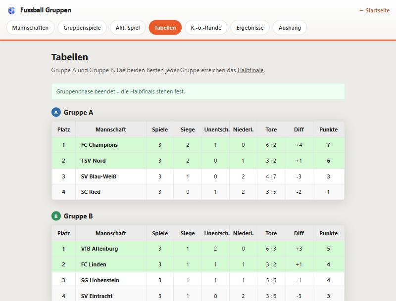
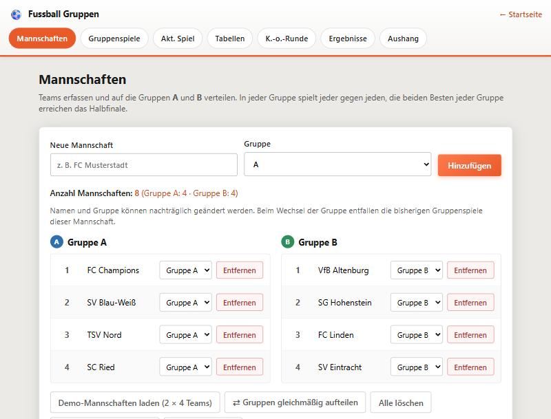
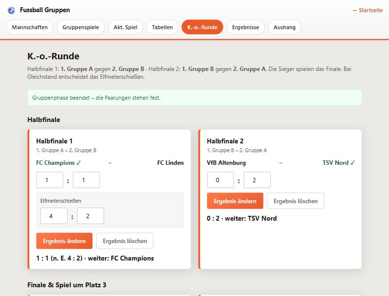
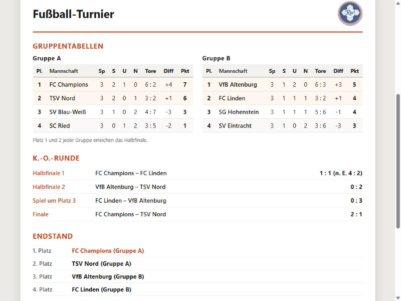

# Fussball Gruppen

Turnierverwaltung mit **zwei Gruppen (A/B), Halbfinale und Finale**, die vollständig im Browser läuft: Mannschaften auf die Gruppen verteilen, Gruppenspiele eintragen, zwei Tabellen führen, die K.-o.-Runde entscheiden und einen druckfertigen Aushang erzeugen.

**Keine Installation, kein Server, kein Build-Werkzeug.** Ordner herunterladen, `index.html` öffnen — fertig. Auch vom USB-Stick.

👉 **Direkt ausprobieren: [rwhexa.github.io/FussballGruppen](https://rwhexa.github.io/FussballGruppen/)**

<p align="center">
  
</p>

---

## Der Turniermodus

```
Gruppe A  (jeder gegen jeden)        Gruppe B  (jeder gegen jeden)
      1.        2.                         1.        2.
       \         \                        /         /
        \         `--- Halbfinale 2 ---´         /
         `-------- Halbfinale 1 -----------------´

  Sieger HF1 – Sieger HF2        →  Finale
  Verlierer HF1 – Verlierer HF2  →  Spiel um Platz 3
```

- **Halbfinale 1:** 1. Gruppe A gegen 2. Gruppe B
- **Halbfinale 2:** 1. Gruppe B gegen 2. Gruppe A
- Bei Gleichstand in einem K.-o.-Spiel entscheidet das **Elfmeterschießen** — ohne Sieger wird das Ergebnis nicht angenommen
- Die Paarungen der K.-o.-Runde werden **nicht gespeichert**, sondern aus den Gruppentabellen und den Halbfinals errechnet. Ändert sich ein Gruppenergebnis nachträglich, fällt das auf: die Seite weist auf die veraltete Paarung hin

## Was sie kann

- **Mannschaften** anlegen, umbenennen, löschen und per Auswahlfeld zwischen Gruppe A und B wechseln — mit Knopf *Gruppen gleichmäßig aufteilen*
- **Gruppenspiele** nur innerhalb einer Gruppe; offene Begegnungen („jeder gegen jeden“) stehen als anklickbare Liste bereit und setzen die Paarung ins Formular
- **Zwei Tabellen** nach Punkten → Tordifferenz → erzielten Toren → Name; Platz 1 und 2 sind grün hinterlegt (Halbfinale)
- **K.-o.-Runde** mit Halbfinale, Spiel um Platz 3, Finale, Elfmeterschießen und Endstand von Platz 1 bis 4
- **Akt. Spiel** — große Live-Anzeige für Beamer oder zweiten Bildschirm. Sie erkennt selbst, ob die gewählte Begegnung ein Gruppenspiel oder ein K.-o.-Spiel ist, und trägt das Ergebnis an der richtigen Stelle ein
- **Aushang** — A4-Seite zum Ausdrucken oder als PDF: beide Gruppentabellen, die K.-o.-Runde, der Endstand und alle Gruppenergebnisse
- **Sichern und Laden** des kompletten Turniers als `.json`-Datei
- Alle Seiten aktualisieren sich gegenseitig, auch über mehrere Browser-Tabs hinweg

## Die Seiten

| Seite | Zweck |
|---|---|
| `index.html` | Startseite mit Poster und Menü |
| `mannschaften.html` | Teams verwalten und auf Gruppe A/B verteilen |
| `spiele.html` | Gruppenspiele, offene Begegnungen, Ergebnisse |
| `aktspiel.html` | Live-Anzeige für Zuschauer |
| `tabellen.html` | Tabelle Gruppe A und Gruppe B |
| `ko.html` | Halbfinale, Spiel um Platz 3, Finale, Endstand |
| `ergebnisse.html` | Übersicht aller Partien |
| `aushang.html` | Druckfertige A4-Übersicht |

<p align="center">
  
  
</p>

---

## Schnellstart

Am schnellsten über die veröffentlichte Fassung: **[rwhexa.github.io/FussballGruppen](https://rwhexa.github.io/FussballGruppen/)**

Oder lokal: Repository herunterladen (grüner Knopf *Code* → *Download ZIP*), entpacken und `index.html` im Browser öffnen.

Unter *Mannschaften* gibt es den Knopf **„Demo-Mannschaften laden (2 × 4 Teams)"** — damit ist in zwei Klicks ein vollständiges Turnier zum Ausprobieren da.

### Mit lokalem Server

Nicht nötig, aber sauberer (echte UUIDs statt Ersatz-IDs):

```bash
python -m http.server 5500
```

Dann `http://localhost:5500` aufrufen.

### Für den Beamer

`aktspiel.html` öffnen, Begegnung wählen — die Zeile unter der Auswahl sagt, als was das Ergebnis eingetragen wird (z. B. *Gruppe A* oder *Halbfinale 1*). Dann **Steuerung ausblenden** (Taste `H`) und **Vollbild** (Taste `F`).

| Taste | Wirkung |
|---|---|
| `1` / `2` | Tor für Heim / Gast |
| `Shift`+`1` / `Shift`+`2` | Tor zurücknehmen |
| `N` | nächstes Spiel nach oben holen |
| `H` | Steuerung ein- und ausblenden |
| `F` | Vollbild |

---

## Der Aushang

Beide Gruppentabellen, die K.-o.-Runde und der Endstand auf einem Blatt:



---

## Technik

Reines HTML, CSS und JavaScript ohne Abhängigkeiten — kein Framework, kein npm, kein Bundler.

Die gesamte Datenhaltung steckt in **[`js/turnier-store.js`](js/turnier-store.js)**. Alle Daten liegen unter einem Schlüssel (`fgr-turnier-v1`) im `localStorage` des Browsers.

Der tragende Gedanke: **Gespeichert werden nur Mannschaften (mit Gruppe), Gruppenergebnisse und die vier K.-o.-Ergebnisse.** Punkte, Platzierungen, Halbfinal-Paarungen und der Endstand stehen nirgends in der Datei — sie werden bei jedem Lesezugriff neu berechnet. Dadurch können Tabelle und Turnierbaum nicht veralten oder den Ergebnissen widersprechen.

```
├── index.html  mannschaften.html  spiele.html  aktspiel.html
├── tabellen.html  ko.html  ergebnisse.html  aushang.html
├── assets/        Poster und Logo
├── css/           global, layout und je eine Datei pro Seite
└── js/
    ├── turnier-store.js   die Datenschicht (Gruppen, Tabellen, K.-o.-Runde)
    ├── datentransfer.js   Sichern und Laden
    ├── nav.js             aktiver Menüpunkt
    └── je eine Datei pro Seite
```

### Datei aus „Fussball Turnier Web“ laden

Eine `.json`-Datei aus dem Vorgängerprojekt lässt sich hier öffnen: die Mannschaften werden reihum auf Gruppe A und B verteilt. Spiele, die dadurch über Gruppengrenzen gehen, kann dieses Programm nicht übernehmen — es meldet, wie viele das waren.

## Grenzen

- Pro Gruppe wird **einfache Runde** gespielt (jeder gegen jeden einmal); Hin- und Rückrunde ist nicht vorgesehen
- Genau zwei Gruppen, genau vier K.-o.-Spiele — kein Viertelfinale, keine freie Gruppenzahl
- Keine Anstoßzeit, kein Spielfeld, keine mitlaufende Spielzeit
- Die Daten liegen pro Browser — der Austausch zwischen Geräten läuft über die Exportdatei

## Verwandte Projekte

- [**FussballTurnierWeb**](https://github.com/RwHexa/FussballTurnierWeb) — die Fassung mit einer einzigen Liga-Tabelle, Vorlage für dieses Projekt
- [**FussballTurnier**](https://github.com/RwHexa/FussballTurnier) — die ältere Delphi/VCL-Version mit Gruppen, KO-Runde und Beamer-Turnierbaum

---

## Lizenz

[MIT](LICENSE) — © 2026 Reinhard Wermeling

Die MIT-Lizenz gilt für den Quellcode, die Dokumentation und das Poster der Startseite.

**Eine Ausnahme** (siehe [NOTICE](NOTICE)): `assets/logorw96.png` — das Rw-Logo ist eine Herkunftskennzeichnung des Autors und nicht Teil der Lizenz. Beim Weiterverwenden bitte durch ein eigenes Logo ersetzen; die Anwendung läuft auch ohne, es fehlt dann nur die Signatur im Kopf des Aushangs.
